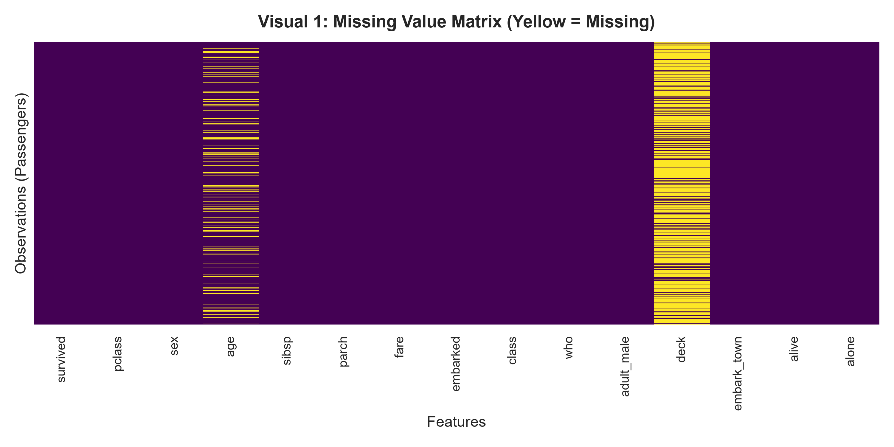
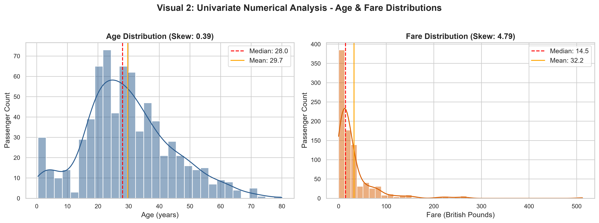
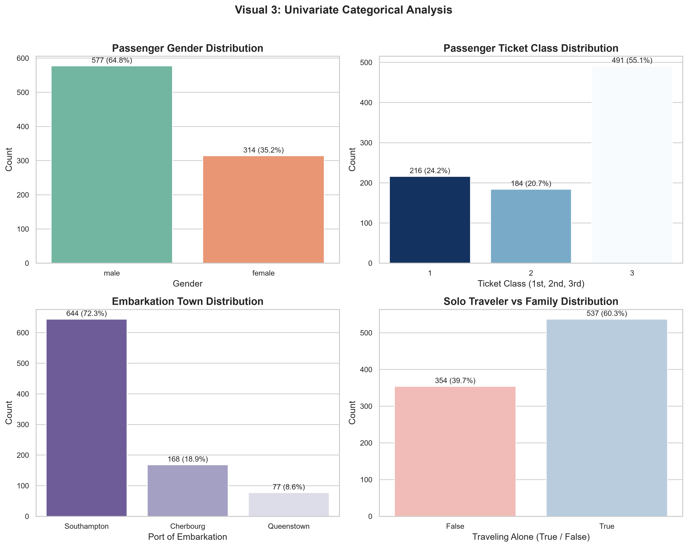
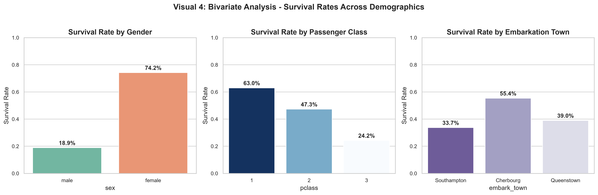
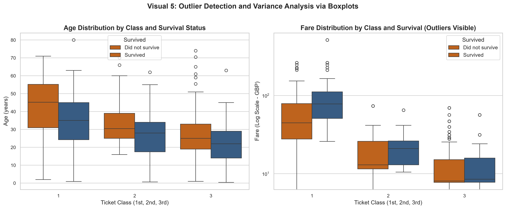
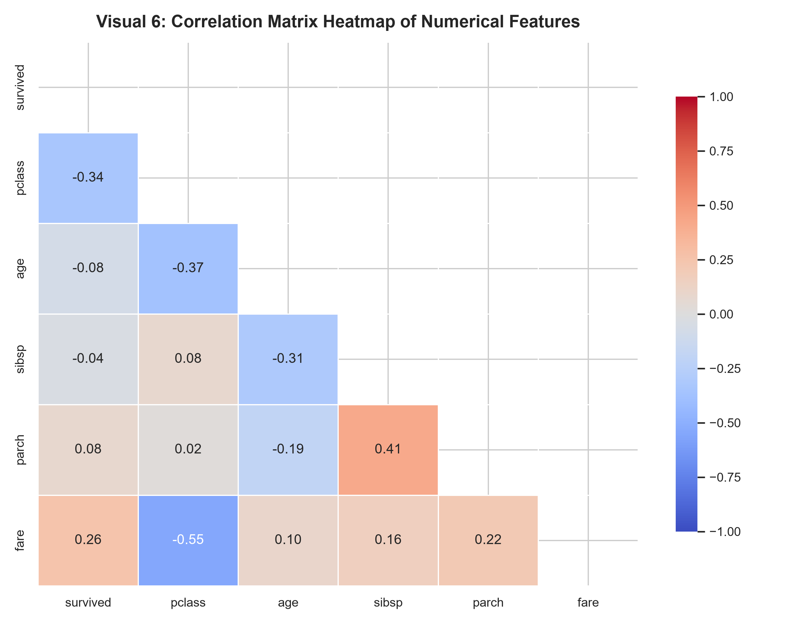
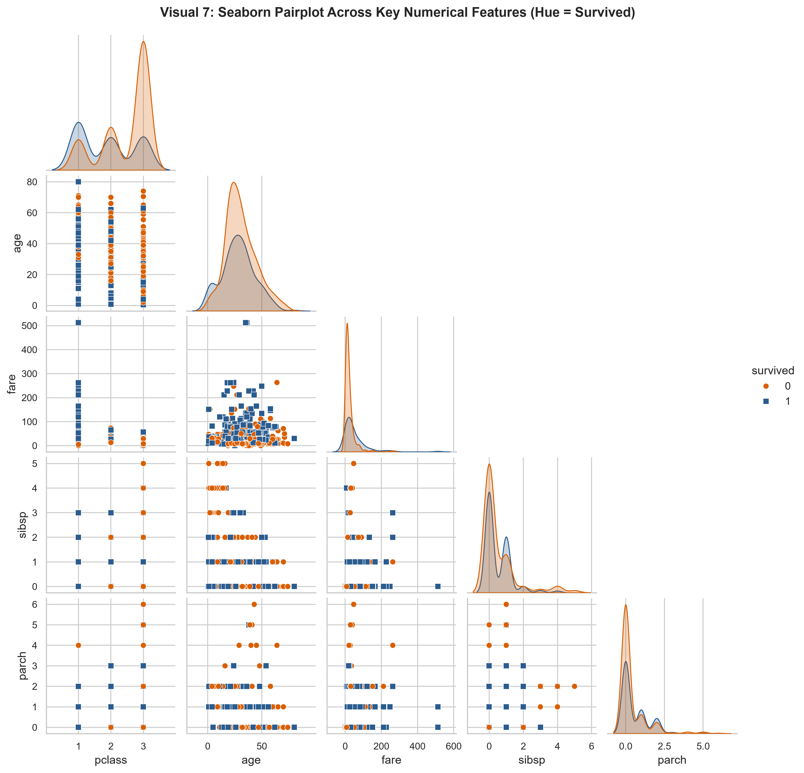
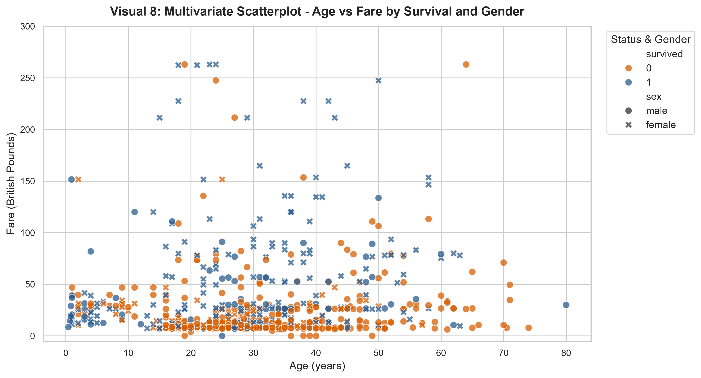
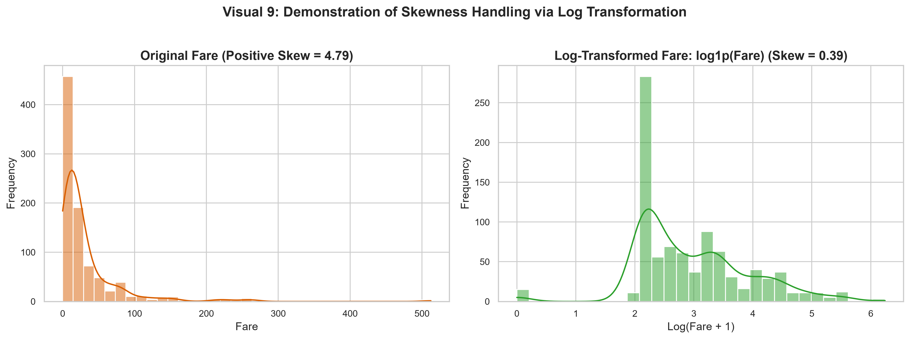
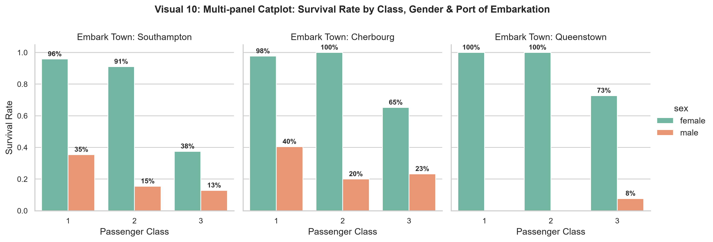

# Elevate Labs Data Analyst Internship — Task 5: Exploratory Data Analysis (EDA)


---

## 📌 Project Overview
This repository contains the complete deliverables for **Task 5: Exploratory Data Analysis (EDA)** as part of the **Elevate Labs Data Analyst Internship** (MSME certified).

The goal of this project is to perform a systematic visual and statistical exploration of the historical **Titanic Passenger Dataset** to extract patterns, trends, relationships, and anomalies that governed passenger survival during the 1912 maritime disaster.

---

## 🗂️ Repository Structure

```text
├── titanic.csv                          # Raw Titanic Passenger dataset (N = 891)
├── titanic_eda.ipynb                    # Complete interactive Jupyter Notebook with EDA code & explanations
├── Titanic_EDA_Findings_Report.pdf      # Publication-quality multi-page PDF findings report
├── generate_figures.py                  # Python script to generate high-resolution visualization charts
├── generate_pdf_report.py               # ReportLab automation script compiling the PDF report
├── build_notebook.py                    # Script generating the structured notebook format
├── README.md                            # Comprehensive project overview, insights, and interview Q&A
└── images/                              # 10 High-resolution statistical visualization charts
    ├── 01_missing_values_heatmap.png
    ├── 02_univariate_distributions.png
    ├── 03_categorical_counts.png
    ├── 04_survival_by_demographics.png
    ├── 05_boxplots_age_fare_by_class.png
    ├── 06_correlation_heatmap.png
    ├── 07_pairplot_titanic.png
    ├── 08_scatterplot_age_vs_fare.png
    ├── 09_skewness_transformation.png
    └── 10_multivariate_catplot.png
```

---

## 📊 Summary of Key Findings

1. **Overall Survival Baseline:**  
   Out of 891 passengers on record, **342 survived (38.38%)** and **549 perished (61.62%)**.
2. **Gender as the Primary Survival Determinant:**  
   Female survival rate reached **74.20%**, compared to only **18.89%** for male passengers ($\chi^2 = 260.72, p < 10^{-57}$), verifying strict compliance with the maritime protocol *"Women and children first"*.
3. **Socio-Economic Disparity:**  
   1st Class passengers experienced a **62.96%** survival rate, 2nd Class experienced **47.28%**, and 3rd Class collapsed to **24.24%** ($\chi^2 = 102.89, p < 10^{-22}$). Cabins on upper decks provided prompt lifeboat access and privilege.
4. **Age Dynamics:**  
   Young children ($\le 9$ years) achieved a ~61% survival rate across 1st and 2nd class, whereas elderly passengers ($\ge 60$ years) suffered the highest casualty rate (~78%).
5. **Family Size Non-Linearity:**  
   Solo travelers had a **30.35%** survival rate. Passengers in small nuclear families (2–4 members) peaked at **57.88%** survival, while large families ($\ge 5$ members) had poor survival (**14.89%**) due to evacuation coordination difficulties.
6. **Ticket Fare Skewness & Log Transformation:**  
   The raw `fare` feature exhibited extreme rightward skewness (**+4.79**). Applying a $\log(1 + x)$ transformation successfully compressed extreme outliers and normalized skewness down to **+0.39**.

---

## 📈 Visual Highlights & Observations

### Visual 1: Missing Data Heatmap

- **Observations:** `deck` is missing in **77.2%** of records; `age` is missing in **19.9%** (requiring median imputation conditioned on class and sex); `embarked` is missing in only **0.22%** (mode imputation).

### Visual 2: Univariate Distributions (Age & Fare)

- **Observations:** Age approximates a bell curve (median = 28.0 yrs). Fare has severe right skew with median £14.45 and extreme luxury fares exceeding £500.

### Visual 3: Univariate Categorical Breakdown

- **Observations:** Males constituted 64.8% of the manifest; 3rd class formed 55.1%; Southampton was the origin for 72.3%; 60.3% traveled unaccompanied.

### Visual 4: Bivariate Survival Rates Across Demographics

- **Observations:** Highlights extreme differences: Females survived at 74.2% vs. 18.9% for males; 1st class survived at 63.0% vs. 24.2% for 3rd class; Cherbourg port passengers survived at 55.4% due to higher 1st-class ticket share.

### Visual 5: Outlier Detection with Boxplots

- **Observations:** Age steadily rises with ticket class tier. Fare shows substantial outlier variance in 1st class. Within all classes, survivors paid higher median fares.

### Visual 6: Correlation Matrix Heatmap

- **Observations:** `pclass` has a moderate negative correlation with `survived` ($r = -0.34$), while `fare` is positively correlated ($r = +0.26$). `pclass` and `fare` exhibit strong inverse correlation ($r = -0.55$).

### Visual 7: Pairplot Across Continuous Variables

- **Observations:** Clear pairwise separation of survivors (blue markers) in the lower class numbers and higher fare regions.

### Visual 8: Multivariate Scatterplot (Age vs. Fare)

- **Observations:** Fares $> £60$ were overwhelmingly survivors regardless of age. In low-fare brackets, young boys and females retained high survival, whereas adult working-class males suffered near-total casualties.

### Visual 9: Handling Skewed Data (Log Transformation)

- **Observations:** Raw fare skewness of **+4.79** is reduced to **+0.39** via `np.log1p()`, forming a stable quasi-normal distribution ready for machine learning.

### Visual 10: Multi-Panel Catplot (Class x Gender x Embarkation)

- **Observations:** Females in 1st/2nd class achieved near 100% survival across all ports. 3rd class women had survival cut to 37–50%, proving socio-economic vulnerability.

---

## 🎯 Answers to Internship Interview Questions

### 1. What is EDA and why is it important?
**Answer:**  
**Exploratory Data Analysis (EDA)** is the systematic approach of analyzing datasets through summary statistics and visual representations to uncover underlying patterns, test hypotheses, identify anomalies, and verify data quality assumptions before modeling. Coined by John Tukey in 1977, its core importance includes:
- **Assessing Data Quality:** Identifying missing values, duplicate records, corrupt entries, and outliers.
- **Understanding Data Distribution:** Evaluating central tendency, spread, skewness, and modality.
- **Uncovering Relationships:** Detecting linear and non-linear correlations, feature interactions, and class separations.
- **Guiding Feature Engineering & Model Selection:** Informs optimal transformations (e.g., log transforms, binning, encoding) and algorithm suitability.

### 2. Which plots do you use to check correlation?
**Answer:**  
- **Correlation Matrix Heatmap (`sns.heatmap`):** Displays a 2D color-coded grid of Pearson ($r$), Spearman ($\rho$), or Kendall ($\tau$) correlation coefficients with values from $-1$ to $+1$.
- **Scatterplot (`sns.scatterplot`):** The primary plot for assessing bivariate correlation, linearity, direction, and spread between two continuous variables.
- **Pairplot (`sns.pairplot`):** Generates all pairwise bivariate scatterplots alongside diagonal univariate distributions.
- **Jointplot (`sns.jointplot`):** Combines a central bivariate scatter/KDE plot with marginal histograms.
- **Regression Plot (`sns.regplot`):** Visualizes scatter points with an Ordinary Least Squares (OLS) regression line and 95% confidence interval.

### 3. How do you handle skewed data?
**Answer:**  
Skewed data violates normality assumptions and destabilizes linear/parametric models. Methods to handle it include:
1. **Mathematical Transformations:**
   - **Log Transformation (`np.log1p`):** Ideal for right-skewed non-negative data (e.g., ticket fares, revenue). Safely handles zeros via $\log(1 + x)$.
   - **Square Root (`np.sqrt`):** Moderately reduces right skewness on count data.
   - **Box-Cox (`scipy.stats.boxcox`):** Optimizes parameter $\lambda$ for maximum normality (requires $x > 0$).
   - **Yeo-Johnson (`scipy.stats.yeojohnson`):** Extends Box-Cox to handle zero and negative values.
2. **Outlier Capping / Winsorization:** Clamps values exceeding $[Q_1 - 1.5 \times \text{IQR}, Q_3 + 1.5 \times \text{IQR}]$.
3. **Discretization / Binning:** Segmenting continuous skewed features into ordinal categories (e.g., Low, Mid, High fare tiers).
4. **Tree-Based Models:** Utilizing decision tree ensembles (Random Forest, XGBoost) which are invariant to monotonic transformations.

### 4. How to detect multicollinearity?
**Answer:**  
Multicollinearity occurs when independent features are highly correlated, inflating coefficient variances and causing unstable regression weights. Detection methods:
- **Variance Inflation Factor (VIF):** Computed as $\text{VIF}_i = \frac{1}{1 - R_i^2}$. A $\text{VIF} = 1$ indicates no correlation; $1 < \text{VIF} < 5$ is moderate and acceptable; $\text{VIF} \ge 5$ or $10$ indicates severe multicollinearity requiring feature removal or regularization.
- **Correlation Matrix Inspection:** Flagging pairwise correlation values where $|r| > 0.80$.
- **Condition Number ($\kappa$):** Calculated from eigenvalues of the standardized feature matrix $X^T X$. A condition number $> 30$ indicates strong multicollinearity.
- **Tolerance:** The reciprocal of VIF ($\text{Tolerance} = 1 / \text{VIF} = 1 - R_i^2$). Values below $0.1$ indicate high collinearity.

### 5. What are univariate, bivariate, and multivariate analyses?
**Answer:**  
- **Univariate Analysis:** Analyzes **one single variable** in isolation to explore its distribution, central tendency (mean, median, mode), spread (variance, IQR), and frequency. *Examples: Histograms, KDE plots, countplots.*
- **Bivariate Analysis:** Investigates the statistical relationship and dependency between **two variables**. *Examples: Scatterplots, cross-tabulations, comparative bar charts.*
- **Multivariate Analysis:** Evaluates relationships between **three or more variables** simultaneously to detect interaction effects, conditional probabilities, and high-dimensional clustering. *Examples: Correlation heatmaps, pairplots, FacetGrids, PCA biplots.*

### 6. Difference between heatmap and pairplot?
**Answer:**  

| Dimension | Heatmap (`sns.heatmap`) | Pairplot (`sns.pairplot`) |
| :--- | :--- | :--- |
| **Data Input** | 2D matrix of aggregated summary values (e.g., correlation grid). | Raw row-level passenger dataset across multiple features. |
| **Plot Content** | Uniform color-coded grid with numerical annotations. | Multi-panel grid of individual subplots (scatterplots and KDEs). |
| **Categorical Splitting** | Cannot directly split points by class label. | Easily splits distributions by categorical targets via `hue`. |
| **Computational Cost** | Extremely fast and lightweight. | Heavier computation on large high-dimensional datasets. |
| **Primary Use Case** | Macro-level check for collinearity and correlation strength. | Deep exploration of non-linear trends, cluster separation, and bivariate interactions. |

### 7. How do you summarize your insights?
**Answer:**  
To effectively communicate findings to both technical stakeholders and executive leadership:
1. **BLUF (Bottom Line Up Front):** Lead with the core strategic conclusion in 1–2 sentences before technical details.
2. **Quantify Every Finding:** Support statements with exact metrics, percentages, and statistical significance ($p$-values) rather than vague generalities.
3. **Pair Visuals with Contextual Takeaways:** Provide concise observations explaining what each chart proves and why it matters.
4. **Group Thematically:** Organize findings into logical segments (e.g., Demographics, Socio-Economic Drivers, Data Quality Risks).
5. **Actionable Recommendations:** Conclude with clear, practical steps for engineering, modeling, or business strategy.

---

## 🛠️ How to Run Locally

1. **Clone this repository:**
   ```bash
   git clone <YOUR_GITHUB_REPO_URL>
   cd task5
   ```
2. **Install required dependencies:**
   ```bash
   pip install pandas numpy matplotlib seaborn scipy reportlab
   ```
3. **Generate visualizations:**
   ```bash
   python generate_figures.py
   ```
4. **Generate the PDF Report:**
   ```bash
   python generate_pdf_report.py
   ```
5. **Open the Jupyter Notebook:**
   ```bash
   jupyter notebook titanic_eda.ipynb
   ```
